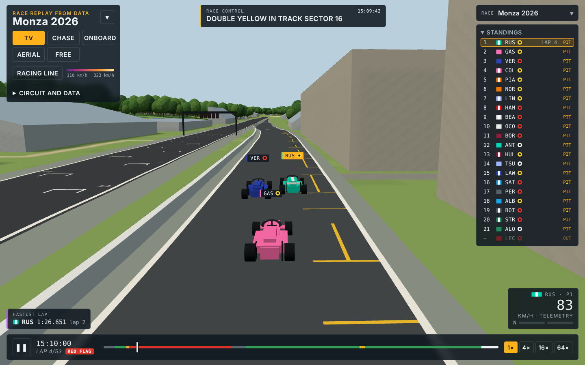
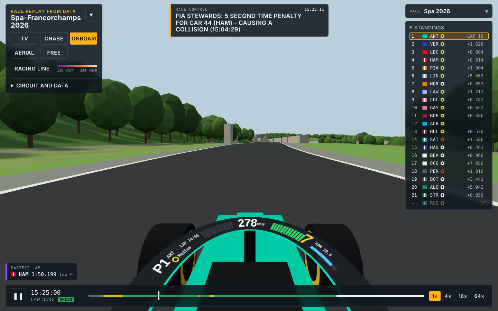
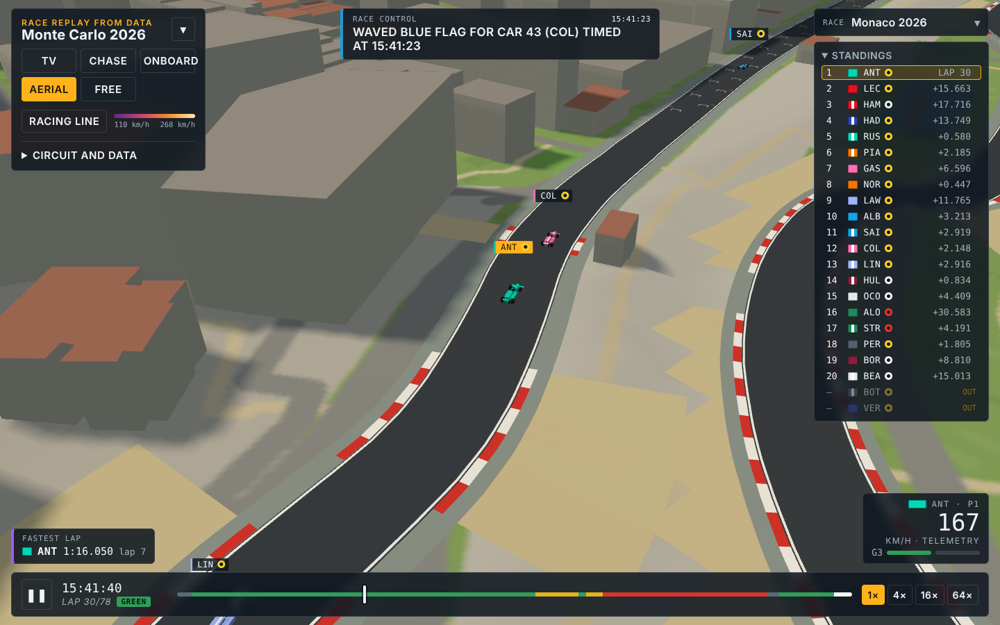
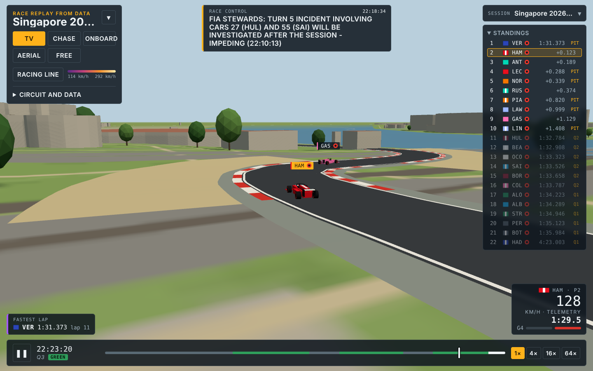
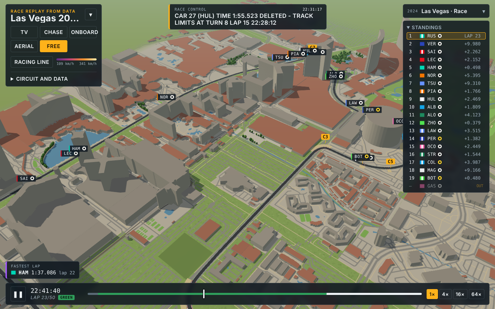
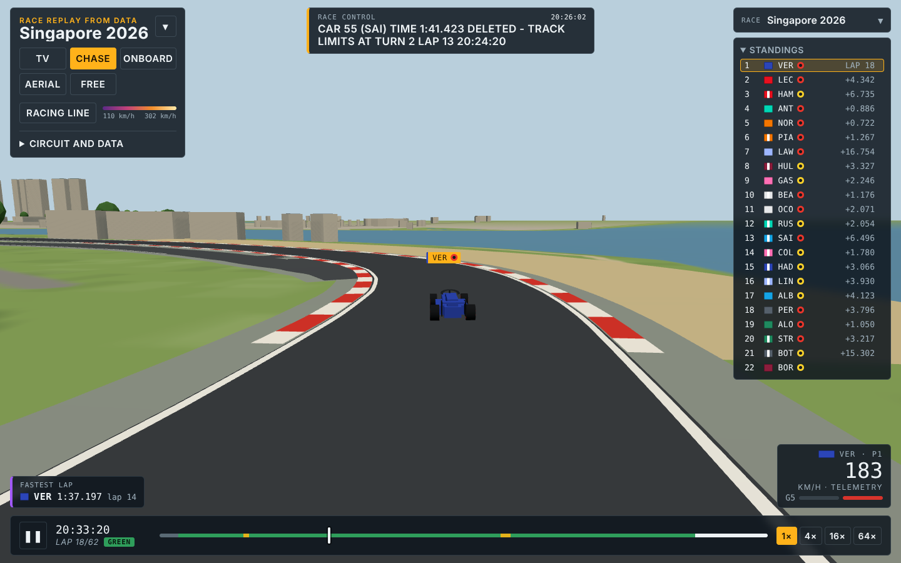
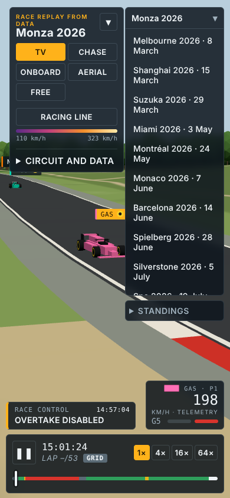

# Race Rewind

**Rewatch Formula 1 (F1) races, sprints and qualifying from 2023 to today in 3D in your browser, built from public timing data and open map data.**



Race Rewind rebuilds each session as a 3D scene you can watch like a TV broadcast: trackside cameras, an onboard view with telemetry on the halo, a helicopter shot, live standings and race control messages. Cars are simple shapes in team colours with each driver's three-letter code. There are no logos, liveries or official graphics.

It is the first piece of a larger idea: a customisable *virtual pitwall* where data dashboards snap onto a grid around the replay.

> Unofficial fan project, not associated with Formula 1 or the FIA. Non-commercial.

## Features

- **Every weekend since 2023:** about 220 sessions over four seasons. Each has its race, qualifying and, on sprint weekends, the sprint and sprint qualifying, all on that circuit's own 3D world.
- **Pick a season, a track and a session** from the menu at top right.
- **Qualifying** shows Q1/Q2/Q3 standings with knocked-out drivers, a running lap timer for the followed car, and hides cars while they sit in the garage.
- **Five cameras:**
  - TV: trackside cameras that cut as the car passes.
  - Chase: behind the car.
  - Onboard: with speed, gear, throttle, brake and RPM on the halo.
  - Aerial: helicopter view.
  - Free: orbit with mouse or touch.
- **Broadcast-style graphics:**
  - standings with gaps, tyre compound and pit/out status
  - race control feed
  - fastest lap box
  - start lights that go out at the real moment
  - a timeline coloured by track status (green, safety car, VSC, red flag)
- **Playback** at 1×, 4×, 16× or 64×, or scrub anywhere in the race. Tap a driver to follow them.
- **Computed racing line**, coloured by speed.
- **Works on every screen:** desktop, tablet, and phone in portrait or landscape.

| Onboard (Spa) | Aerial (Monaco) |
|---|---|
|  |  |

| Qualifying (Singapore 2026, Q3) | Free camera (Las Vegas 2024) |
|---|---|
|  |  |

| Chase (Singapore) | Phone |
|---|---|
|  |  |

## Quick start

The site is static files, so any web server works:

```bash
python3 -m http.server 8000 -d web
# open http://localhost:8000/
```

The page opens the latest race. Link to any session directly with `?gara=<OpenF1 session_key>`, for example `?gara=11384` for Singapore 2026 qualifying.

The `web/` folder is the whole site. It deploys as is to any static host; this repo is set up for Cloudflare Pages with `web` as the output directory and no build command.

## Building sessions

From the `pipeline/` folder:

```bash
python3 -I catalogue/plan.py              # list every weekend in OpenF1 (2023 to now)
python3 -I catalogue/build_all.py 2026    # build what isn't built yet (all seasons if no year given)
python3 -I catalogue/make_index.py        # refresh web/races/index.json
```

`build_all.py` builds each weekend's race first, which also builds the circuit's 3D world, then the other sessions on that world. It is resumable, and map data is downloaded once per circuit. Single sessions can be built by hand:

```bash
tools/add_race.sh <race session_key> <f1-circuits id, e.g. nl-1948> work/<key> ../web/races/<key>
tools/add_session.sh <session_key> work/<race key> ../web/races/<race key>/world.json work/<key> ../web/races/<key>
```

**Requirements:**
- Python 3 with numpy, shapely, pyarrow and Pillow (build only; the site itself is plain HTML and JavaScript).
- Network access to api.openf1.org, the Overture Maps S3 bucket, the AWS Terrarium tiles and raw.githubusercontent.com.

## How it works

```
OpenF1 (positions, telemetry, laps, flags…)  ──► tools/fetch_openf1.py
                                                   │
                       tools/world_from_feed.py ◄──┤  track shape from car positions
Overture Maps + Terrarium ─► tools/fetch_scenery.py, build_world.py
                       tools/fit_feed.py, place_feed_track.py   align track to map
                                                   │
                                     build_replay.py ─► web/races/<session_key>/
                                                   │
                     web/index.html (three.js) reads web/races/index.json
```

1. **Track.** The track shape comes from the cars themselves: about 25 clean laps of position data are averaged.
2. **World.** Terrain, buildings, grandstands, trees, water and roads come from Overture Maps (OpenStreetMap data), with elevation from Terrarium tiles. The track is aligned to the map automatically, usually within 1.5 to 3.5 m.
3. **Replay.** Car positions are rebuilt at 4 Hz from speed telemetry, kept in check by the reported positions, and placed on a computed minimum-curvature racing line.
4. **Race data.** The replay also carries:
   - a 22-slot starting grid
   - pit stops, tyre stints and retirements
   - flags and race control messages
   - gaps and fastest laps
   - lights-out timing

5. **Qualifying.** Phases come from the session status messages, lap times drop laps the stewards deleted, and the final classification decides who was knocked out where.

A race is about 2.8 MB to load and a qualifying session about 1.5 MB. The whole catalogue is around 560 MB.

**Nothing is tuned per session.** The same code copes with the feed's quirks across every season:
- cars that never started
- placeholder positions far off the track
- races with no "race start" message (lights-out is found from telemetry)
- formation laps behind the safety car
- pit lanes the feed hides
- Monaco 2026, where positions are missing for most of the race
- rolling starts, restarts after a red flag with no green message, and races with no chequered flag message

Sessions where the data still has gaps are marked with ✱ in the menu, and the page lists what is missing.

A prototype live engine (`tools/live_engine.py`) does the same smoothing in real time, about 4 s behind. In simulation it stays within 1 m of the offline replay. It is not connected to a live source yet.

## Limitations

- **No real per-car lines.** The feed puts every car on practically the same line, so cars follow a computed racing line. Battles and line choices through corners are not real.
- **Monaco 2026 is approximate.** Positions there come from speed and lap times, and there is no pit lane.
- **Hungaroring's pit lane is too short,** because its pit timing doesn't match the speed data.
- **Delayed starts:** the timeline can turn green a few minutes before lights out (Sepang).
- **The scenery is generic.** Map data has no kerbs, run-off, barriers or pit buildings, and elevation is rough in cities.
- **Positions are smoothed over about 2 s,** so spins and contact look softer than they were.
- **Missing data:** 2023 Melbourne qualifying is not available (OpenF1 only has its last 10 minutes), and 2025 Baku qualifying has no lap times, so its standings show no times.
- **Prototype code:** a single HTML page plus Python scripts, with no automated tests.

## Roadmap

- [ ] Snap-on pitwall dashboards around the replay
- [ ] Automatic build of each new weekend after it runs
- [ ] Practice sessions
- [ ] Team radio transcripts (text only)
- [ ] Live races
- [ ] Better pit lanes for Monaco and the Hungaroring

## Data and licences

- **[OpenF1](https://openf1.org)** timing and telemetry, CC BY-NC-SA 4.0. The underlying data belongs to Formula 1, so this project stays non-commercial and uses no radio audio or video.
- **[bacinger/f1-circuits](https://github.com/bacinger/f1-circuits)** circuit outlines, MIT.
- **[Overture Maps](https://overturemaps.org)** © OpenStreetMap contributors, ODbL.
- **Terrarium elevation tiles**, AWS Open Data.
- **[three.js](https://threejs.org)**, MIT.

F1, FORMULA 1 and related marks are trademarks of Formula One Licensing B.V. This project is not affiliated with them.

## Repository layout

| Path | What it is |
|---|---|
| `web/index.html` | The page |
| `web/races/` | `index.json` plus one folder per session (`replay.json`, `replay-pos.txt`, `replay-tel.txt`); race folders also hold the circuit's `world.json` |
| `pipeline/build_replay.py` | Session data to replay files |
| `pipeline/tools/` | Download, 3D world and alignment scripts, plus the live engine and simulator |
| `pipeline/catalogue/` | Season catalogue, batch build and index scripts |
| `docs/` | Screenshots |
